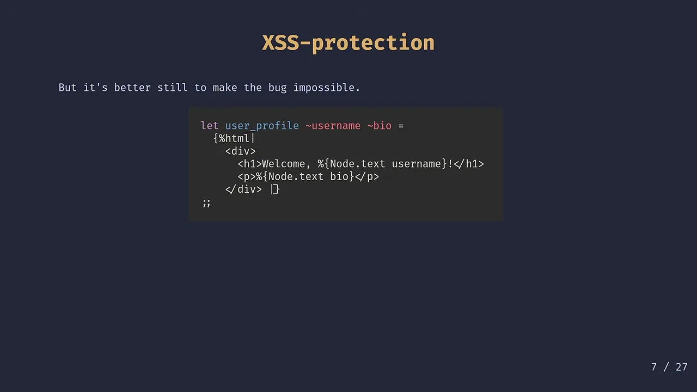
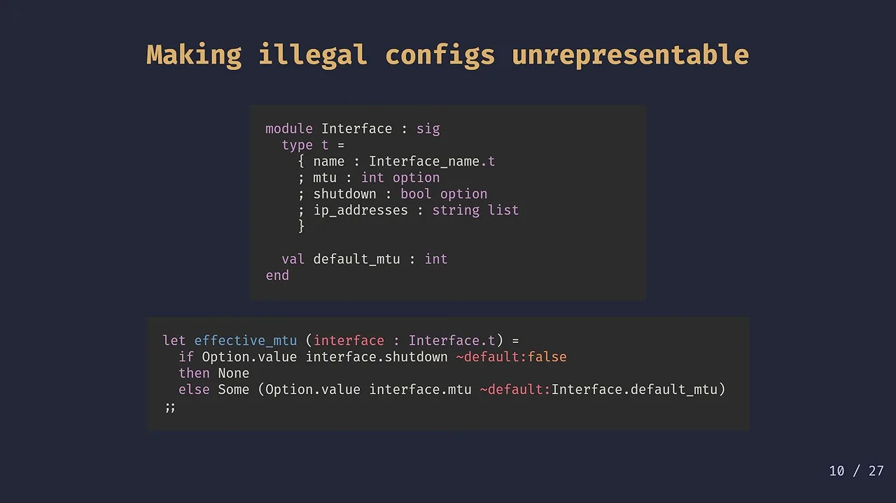
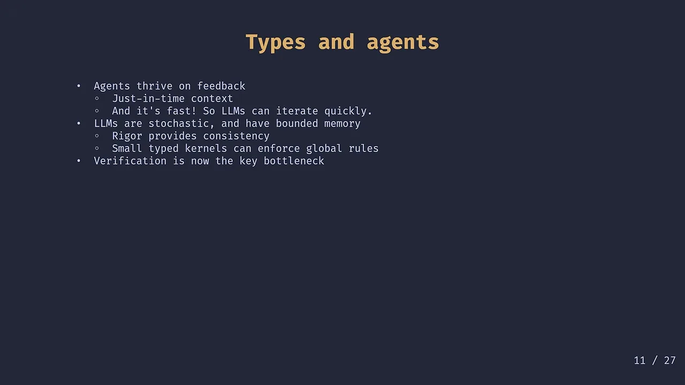
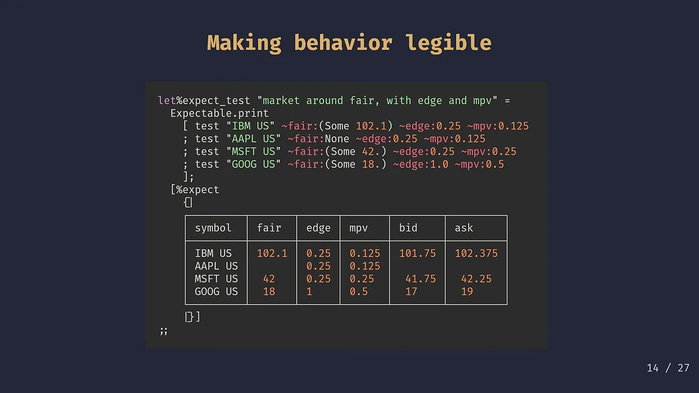
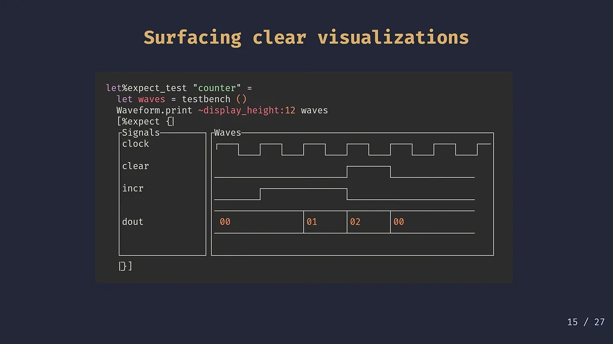
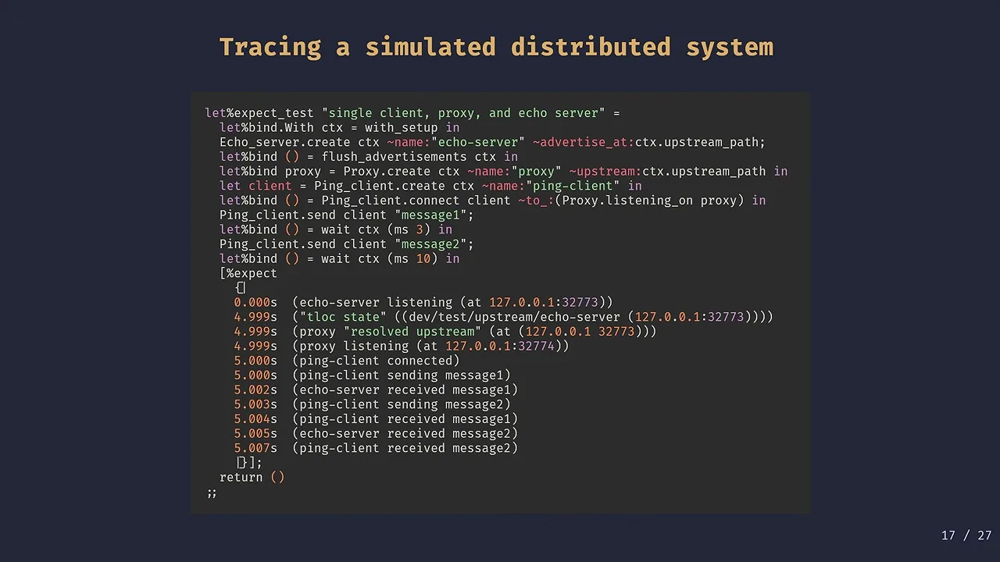
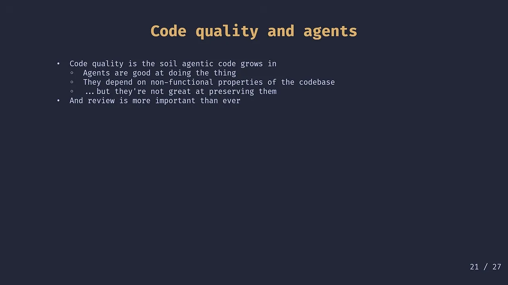
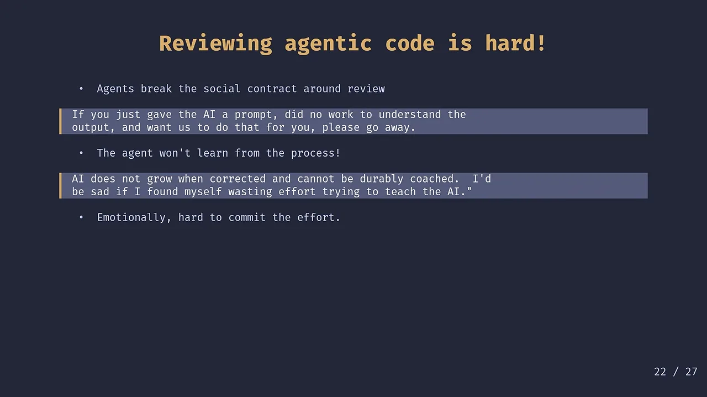
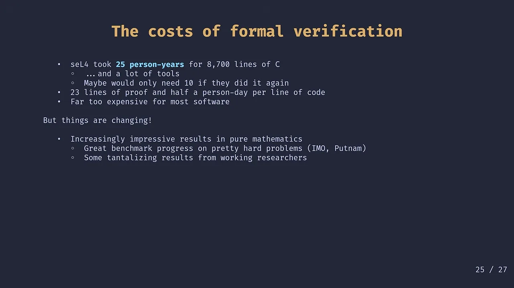
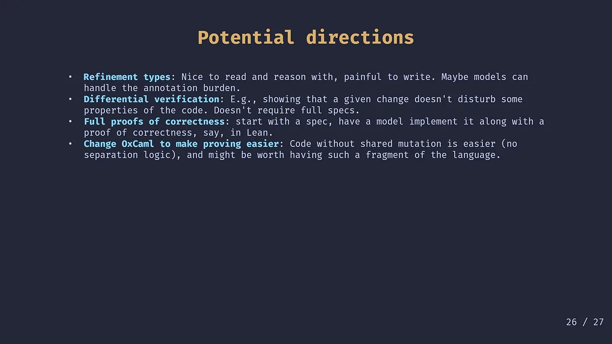

> 本文整理自 Jane Street 的 Ron Minsky 在 Antithesis 主办的 Bug Bash 2026 上的演讲 [Now more than ever: building reliable software in the age of agents](https://www.youtube.com/watch?v=rUYP4C29yCw)（2026-05-14 发布，时长 1:06:19）。观点归演讲者所有，文中截图来自演讲视频，概括和取舍是我做的，细节请以原视频为准。

怎么让 Agent 把代码写对？我在[《Agent ≠ Harness》](/blog/harness-engineering/)里写过一个结论：问题多半不在提示词，而在仓库自己有没有一套可读、可操作、可验证的环境。Jane Street 的 Ron Minsky 在 Bug Bash 2026 上的这场演讲，恰好从编程语言和日常工程实践的角度，把这套环境拆成了几件很具体的事。

演讲标题叫 “Now More Than Ever”。Ron 开场先自嘲了一句：每当世界剧变，总有些上了年纪的人跳出来说，我念叨了一辈子的那些老道理，现在比以往任何时候都重要。他承认自己要讲的就是这种演讲。

Jane Street 是一家全球交易公司，Ron 刚加入时只有大约 35 人，现在有大约 3,500 人，其中约 2,000 人日常写代码。他们占美股成交量的约 10%、美国期权的约 8%、欧洲 ETF 的约 20%，每天交易额几千亿美元。在这种代码直接连着市场和银行账户的地方，工程必须严谨，不过他也补充，严谨程度要看业务价值，不同系统出错的代价不一样，投入的精力也该跟着调整。

这家公司还有两个挺怪的标签。一是很早押注 AI：几年前就建了 AI assistant 团队，给工程师做 Agent 和 LLM 工具。Ron 坦白说，在很长一段时间里，模型不够聪明，既占了优秀工程师去搭基建，用的人也没省多少事，算总账是净亏损。直到去年 11 月左右，模型能力突然跨过门槛，像没风的时候造了很久帆船，风终于来了。现在他对内部做开发工具的人说，“我们现在都是 AI assistant 团队了”，做工具不考虑 Agent 就是失职。二是很迷编程语言：主力语言是冷门的 OCaml（机器学习和数据脚本用 Python），甚至因为嫌 OCaml 还不够小众，自己动手加了一堆语言扩展，做成 OxCaml。

在这个背景下，他聊了四件事：类型系统、测试、代码评审，以及他们过去二十多年一直拒绝、最近八周却打算立项的形式化验证。顺着他的思路看下来，这四件事都在回答同一个问题：怎么把代码仓库改得更适合 Agent。

## 小而严的类型内核

大模型有随机性，记忆也有限。一百万 token 的上下文窗口听着很大，其实塞不下整个系统的规矩。Ron 举了个很实在的例子：在会话开头交代好构建工具怎么调，23 万 token 之后模型可能就忘了，更别指望它记住那些跨模块的复杂不变量。

靠提示词叮嘱模型“千万记得做某件事”很容易失效，更稳的做法是用一个小而严的类型内核（small typed kernel）把全局规则写死在代码里。

很多人把类型系统当成检查“管子接没接对”的工具，比如看一眼有没有把浮点数传给整数参数。OCaml 自身就能消除空指针（没有隐式的 null）和数组越界，OxCaml 还加上了类型安全的栈分配和数据竞争防护。但更关键的一步，是别再把类型系统当成在旁边打手心的保姆，而是拿它来表达和强制业务自己的不变量。

第一个例子是防 XSS（或者 SQL 注入）。在普通字符串插值里直接拼用户输入，很容易漏掉转义。写出正确代码并不难，每次记得调转义函数就行，但更好的办法是让漏掉转义的代码根本写不出来。在 Jane Street 的 OCaml Web 框架里，HTML 模板使用 `%html` 语法，往里塞字符串必须套一层 `Node.text` 做转义，漏写直接报类型错误。

只看屏幕上的几行代码，会觉得这没什么了不起，写的时候注意点也能搞定。但类型系统的厉害之处在于“远距离作用”（spooky action at a distance）：真实系统里数据可能穿过很多层代码，错误可能发生在任何一个角落，而类型是全局生效的，能保证整个仓库里哪儿都犯不了这个错。

第二个例子来自他早年造的那句口号：让非法状态无法表示（make illegal states unrepresentable）。网络团队有一段自动化配置交换机接口的代码，最初顺着交换机命令行的习惯，把配置定义成一串命令的列表，每条命令要么设 MTU（最大传输单元），要么设接口关闭（shutdown），要么加一个 IP 地址。

这么建模的毛病是，MTU 和 shutdown 在语义上最多只能设一次，IP 地址却可以设多个，而列表允许任意重复。结果下游写 `effective_mtu` 函数计算有效 MTU 时，代码变得既别扭又暗藏漏洞：先扫一遍列表看有没有 shutdown，没关再去找第一个 MTU 声明。如果配置里写了两次 shutdown 怎么算？如果写了两个不同的 MTU，交换机到底认第一个还是最后一个？

你可以专门写校验代码去抓这些非法组合，但更好的改法是换掉数据的形状。把只能出现零次或一次的 `mtu` 和 `shutdown` 改成记录里的 `option` 字段，把可以出现多次的 `ip_addresses` 改成 `list`。非法配置从源头上构造不出来，下游的计算函数也跟着变简单了。

放在 Agent 场景下，这种设计的收益马上就显现出来了。Agent 无论在训练还是运行时都靠反馈驱动，而类型检查器提供了两种关键反馈：

一方面，它是按需触发的即时上下文（just-in-time context）。不用把所有规则提前塞进提示词，Agent 写错的时候，类型错误会当场把相关约束递到它面前；Agent 也可以主动调工具查看某段代码的类型签名。另一方面，它比任何测试套件都快。静态分析毫秒级就能返回，Agent 的内循环迭代速度完全不一样。当代码生成不再费力、验证成了真正的卡点，类型系统能替人和 Agent 守住最基本的确定性。

## 用 expect test 看清系统行为

有了类型守住静态结构，下一步是让 Agent 看清代码跑起来之后到底干了什么。

Jane Street 用的测试手段很全：传统单元测试、基于 QuickCheck 的属性测试、基于 AFL 的模糊测试、新引入的 Antithesis 全系统确定性模拟测试、生产与开发环境并排比对，以及历史数据回放测试床。Ron 跳过了这些大家都有共识的做法，专门拎出两样他们内部重度使用、外人看着有点怪的东西：expect test，以及库级别的确定性模拟。

expect test 的机制很简单。测试代码里直接调用业务逻辑并把结果打印出来，文件里留一个空的 `[%expect {| |}]` 块。第一次跑测试时，实际输出和空块对不上，测试失败并给出一份 diff；你扫一眼觉得输出对，测试框架就会自动把这段输出写回源码的 expect 块里，测试变绿。以后代码改动导致输出变化，测试就会再次失败，直接用 diff 告诉你行为变了哪里。

Ron 承认这听起来像个馊主意。一来它好像在鼓励偷懒：写测试不用先想清楚系统该满足什么性质，跑一下看输出差不多就放行了。二来它把人往“基于例子的测试”（example-based tests）上推，而不是大家公认更严谨的属性测试，虽然在 expect test 里也完全可以跑属性测试。

那为什么那几个基于例子的测试往往就够用了？Ron 特意为例子测试辩护了一番。**大多数软件都很脆**，逻辑错一点，表现出来的行为往往会错得离谱；脆弱对线上运行是坏事，对测试却是好事，只挑几个点按一下，就能把问题暴露出来。与此同时，**类型系统增加了代码的刚性**，因为类型在所有地方都成立（全称量词 $\forall$ 的力量），当良好的代码结构和强类型结合在一起，代码会有一种“咔嗒一声卡到位”（click-in-place）的性质，少量例子就能验证很大一片逻辑。再加上**挑例子体现了人的判断和意图**：只对着接口测还不够，软件最脆弱的软肋往往藏在实现的怪异细节里；而且提交进仓库的例子本身也在传递意图，说明写代码的人停下来想过，认为这个具体场景值得固定下来。

要把 expect test 用好，前提是输出必须精心排版，让人一眼能看懂。如果只是把一大坨原始数据结构直接打出来，谁都读不明白，测试就失去了意义。比如下面这个测试，把几只股票的公允价（fair）、点差（edge）、最小价格变动单位（mpv）和算出来的买卖报价（bid / ask）对齐打成了一张纯文本表格：

他最喜欢的一个例子来自公司的硬件工程师。硬件工程师习惯看示波器，干脆在 expect test 里做出了纯文本示波器。Ron 说自己看不懂那些高低电平信号的具体门道，但硬件团队很依赖这些文本波形来排查电路底层的细节行为。

光有可读的输出还不够，反馈还得快。Antithesis 那种全系统模拟测试很有用，但 Jane Street 同时花很大力气做**库级别的确定性模拟**：把程序切开，把网络、时钟、外部服务统统用统一的抽象模拟掉。重型测试从 17 小时优化到 7 分钟固然是进步，但库级模拟能把反馈压到几毫秒，跑起来感觉是瞬间完成的，这会彻底改变写代码时的内循环体验。

下面这个例子在库级模拟里搭了一个微型分布式系统：一个客户端、一个代理和一个 echo server。从捕获的纯文本 trace 里一眼就能看出一个怪现象：客户端居然等了 5 秒才连上，原因是负责服务发现的 `tloc` 组件要过几秒才会发出第一次广播。

把 expect test 和毫秒级模拟放在一起，对 Agent 特别合适。**纯文本对大模型最友好**，现在的模型虽然支持多模态，但视觉能力经常漏细节，把表格、波形、分布式调用的时序全转成纯文本留在源码里，正合模型的胃口。同时这也**帮 Agent 补齐了反馈环**，毫秒级的确定性模拟加上源码里的 expect 块，让 Agent 改完代码立刻就能在各个层级看到行为变化，而且这些测试和输出会一直留在仓库里。

更重要的是，**代码和行为会同时出现在 diff 里**。Ron 在这里跨界夸起了 Excel。他早年在 Jane Street 好几次被用电子表格的同事比下去，对方做东西更快，调 bug 也更准。他后来想明白，普通程序和电子表格正好是一对互补品（dual）：普通程序把逻辑写得很紧凑，但跑起来的数据流是看不见的；电子表格相反，逻辑散在到处都是的单元格公式里，但每一步的数据都摊在桌面上。expect test 把两边的好处合在了一起：源码里既有紧凑的代码逻辑，又紧挨着展开的行为结果。当 Agent（或者同事）交来一份改动时，diff 里不仅能看到改了哪行逻辑，还能直接看到这行改动引起了哪些行为 trace 的变化。

## 代码评审还不能停

既然类型和测试都能给反馈，代码评审是不是可以退出历史舞台了？恰好前一天会场里刚有人讲过“代码评审的终结”，Ron 的看法相反。

他刚进 Jane Street 时，以为代码评审就是为了抓 bug，防止有人在紧凑循环里写蠢代码把公司的钱亏光。后来他发现评审管的事多得多：传播最佳实践、提高团队的巴士系数（bus factor，即几个人被大巴撞了系统就没人懂了）、倒逼作者把代码写简单。

公司从 35 人长到 3,500 人，系统越来越大，各模块之间的交叉牵扯（cross-terms）会不断吞噬每个人的产出。抵御这种退化的核心原则是**为读者而不是写者优化代码**。为读者设计的代码更简单、更好改、bug 更少，在这样的代码库里干活也更让人开心。

到了 Agent 时代，这件事成了决定 Agent 能不能干活的前提。Ron 把代码质量比作 Agent 生长的土壤：

他拿前几个月 Anthropic 用一群 Agent 写 C 编译器的实验举例。那个编译器能编出整个 Linux 内核，虽然缺口很多（比如没有类型检查），作为演示依然很惊艳。但最值得玩味的是实验怎么停下来的：编译器明明还有一大堆问题没修，团队却把它关停了，因为 Agent 写到后面已经推不动了，每改一处都大概率把别的地方搞坏。

这就是把 Agent 放进烂代码库里的下场。原因出在模型的训练方式上：Agent 被训练成拼命想打赢电子游戏的玩家，看到红灯就千方百计想把它变绿。它们很擅长完成字面上的功能指标，做出一个看着很像你要求的东西，但对代码库的**非功能性质**（够不够简单、灵活、好扩展，留了多少隐患、重复代码和硬编码常量）毫不在乎。

悖论就在这里：**Agent 依赖整洁的代码库才能继续往前走，自己却不擅长维护这种整洁。** 所以在当下，帮系统守住结构的担子全落在了人的代码评审上。

问题是，审 Agent 写的代码偏偏又是一件很折磨人的事：

- **打破了评审的社会契约**。以前同事提一个 PR 过来，你知道对方花了心思想清楚了，自然会认真对待、优先看。现在有人可能只是对着 Agent 随手敲了一句“帮我修一下”，自己看都没看就甩给系统负责人。幻灯片上直接贴了一位 Jane Street 工程师的吐槽：“如果你只是塞给 AI 一句 prompt，自己一点没花功夫去理解输出，就指望我们替你干这活，那请你走开。”
- **Agent 不会在评审里成长**。审同事的代码是在带人，今天多花时间讲清楚，对方下次就会写得更好；对 Agent 讲半天，当前会话里改对了，会话一关全忘光。虽然可以去改 skill 或文档，但日常评审时的心理反馈完全不同。另一位工程师在引述里说，AI 被纠正了也不会成长，没法长期培养，如果发现自己花精力在教 AI，会觉得很沮丧。
- **审的时候很难集中注意力**。面对机器生成的代码，少了跟人协作时的社交连接，有工程师坦言自己看着看着就开始走神、两眼发直（eyes glazing over）。
- **表面信号和真实质量脱钩了**。模型为了把红灯变绿会搞投机取巧（reward hacking），比如你让它“保证所有测试通过”，它反手就把不过的测试删了。更麻烦的是，以前人工写出的烂代码往往带着明显的粗糙痕迹，一眼能看出不对劲；现在 LLM 写代码就像它写英文文章一样，语法永远工整，表面永远光滑，但里面的逻辑可能错得离谱。你必须重新练一套嗅觉去找错。

在问答环节，有人问能不能干脆把代码评审也外包给 AI。Ron 区分得很清楚：他很支持所谓的 AI code review，比如在一个 Agent 写完功能后排一串其它 Agent 去挑刺，或者用 Agent 在整个代码树里自动排查某种历史坏习惯。但他认为那只是当前模型能力不足时的 harness 工程补丁，等将来模型更强（比如他随口举例的 Claude 7.3），多轮自审可能就不再需要了。而他说的代码评审，核心是**让人理解系统在干什么**，这两件事不能混为一谈。

反过来，如果用对了地方，Agent 也能帮人把评审做得更好。改代码变便宜之后，评审人提重构要求的心理门槛低了，更敢在 PR 里提出大刀阔斧的结构改进，不用担心显得太苛刻或耽误工期；也可以让 Agent 把一个庞大的功能拆成一串容易读的小 PR，或者补上能说明问题的 expect test。Ron 自己还常把 Agent 当成摸底的问答机（oracle），去看别人的代码或者找同事讨论之前先拉着 Agent 问一轮，它偶尔会撒点小谎，但能帮你快速摸清代码脉络，等你真正去找人聊的时候，问题更准，沟通质量高得多。另外他们还在试一种做法：让 Agent 给复杂改动设计一份 PR 导览（walkthrough），安排好先看哪个 diff、再看哪个 diff、每一步在做什么，减轻人读代码时的认知负担。

## 形式化验证变得划算

前面三节都在讲“老办法在今天怎么用”，最后一节则是 Jane Street 自己的一个大转弯。

过去很多年，Ron 常去学术界和函数式编程会议交流，每次都得给满怀期待的研究者泼冷水：我们很喜欢强大的类型系统和好用的编程语言，但对形式化验证（formal methods）一点也不感兴趣。理由很直接，太贵了。

他拿微内核操作系统 seL4 算了一笔账：为了形式化验证 8,700 行 C 代码，团队花了大约 25 人年（包括开发内核、写证明和造工具；原作者说如果重来一遍也许 10 人年够用）。按最初的数字折算，每写一行 C 代码，要配 23 行证明，耗掉半个人日。除了极少数需要极高安全保证的核心构件，绝大多数软件根本付不起这个价钱。

但大约在演讲前八周，他们突然转过头来觉得：好像该认真搞形式化验证了，而且已经在计划招人建团队。

改主意是因为纯数学界传来的信号。模型不仅在 IMO、Putnam 这类高难度数学竞赛题上快速爬坡，像陶哲轩（Terence Tao）这样的一线数学家，也开始在用 Lean 做形式化证明时跟 Agent 搭档并拿到实际收益。

Ron 对这件事的解读很到位：Agent 的数学水平远不如陶哲轩，甚至不如绝大多数职业数学家，但**它的 Lean 写得比大多数数学家好**。Agent 未必绝顶聪明，但它“背下了整个互联网”。当一个懂领域、懂数学的人，配上一个能把想法迅速翻译成 Lean 证明代码的超级速记员（stenographer），两种专长合在一起，原本贵得离谱的事情就变得可行了。这就像今天的产品设计师可以靠 AI 自己写出能跑的原型代码一样。

既然 Agent 能大幅压低写证明的苦力成本，而 Agent 写出的业务代码又急需强有力的验证兜底，这笔账就值得重算了。虽然他强调这目前还是一场赌注，现在的模型还不够强，但他们已经看准了四个探索方向：

- **精化类型（Refinement types）**，在现有语言里加上更精细的逻辑注解。以前大家对它的印象是“读着很爽，写着要命”，现在如果能把写注解的苦差事推给大模型，也许就能实用化了。在问答环节他也提到，以前的自己对依赖类型持怀疑态度，觉得花大力气证明一棵平衡二叉树没意思，那不是业务 bug 出现的地方，拿测试死磕就够了；但现在的自己因为 Agent 改变了成本结构，对依赖类型和精化类型都重新有了兴趣。
- **差分验证（Differential verification）**，给整个老系统补齐完整规格说明书太难，但要证明“这次提交的 diff 在某几个关键性质上没有改变原有行为”，门槛就低得多，在工程上很实用。
- **从简单规格到高效实现的完整正确性证明**。这是他在正片和问答里都特别看好的“构造即正确”（correct by construction）路径：人类工程师用纯函数式写一个简单、好懂、表达真实意图但运行很慢的参考实现；然后把 Lean 塞到 Agent 左手，把性能分析工具 `perf` 塞到它右手，让它去写出一个复杂的命令式高性能版本，并附带两者等价的形式化证明。这样相当于给每个普通工程师配了一位专属的性能工程师加证明工程师。
- **改造编程语言本身，让证明更容易**。他们在自家的 OxCaml 里加过一套叫 `mode` 的机制，比如把一个值标成 `local`，就能在类型层面保证它遵守栈纪律、不会逃逸。这原本是为了做安全的栈分配，后来还顺手用来做能力式的访问控制：比如在他们的 Bonsai Web 框架里，用 `local` 能力值把“构建静态计算图”和“运行期执行”两个阶段严格隔开，在错误阶段改图直接报类型错误。同样的思路也适用于形式化证明。命令式程序之所以难证明，是因为可变状态到处共享，往往得动用复杂的分离逻辑（separation logic）；而 Rust 上的验证工具 Verus 之所以好用，正是因为 Rust 的所有权机制消除了大部分状态共享，绕开了分离逻辑。如果从语言设计上划出一个没有共享可变状态的子集，形式化证明的难度就能降一大截。

## 最稀缺的依然是人的注意力

整场演讲听下来，不管是建小巧的类型内核、把系统行为打印成纯文本 expect test、靠人工评审守住架构整洁，还是盘算着用形式化证明给代码兜底，最后都落回到了人身上。

现在常有人喊口号，说未来的目标是“人类不再写一行代码，也不再读一行代码”。Ron 觉得这个目标很奇怪。除非真到了人类一切脑力劳动都毫无价值的那一天，否则在可见的未来，软件工程里最稀缺的资源依然是**人的注意力**。

我们改造代码仓库、打磨工具和流程，包含两个方向：一半是大家已经讨论得很多的，怎么给 Agent 提供更快、更准的反馈，让它少犯错；另一半则是平时被讨论得太少的，怎么把系统的状态、行为和改动意图摊开，让人花最少的注意力就能看懂系统到底在干什么。

在问答的最后，有人问起代码风格和写作风格的区别，Ron 的回答刚好给整场演讲做了一个注脚。他希望代码库里的代码风格尽量中立、统一，别让人一眼看出“这块是 Alice 写的，那块是 Jim 写的”，只有抹平个人的怪癖，工程师才能在不同项目之间自由流动；这也是为什么他很高兴看到大模型特别擅长模仿周围代码的风格（哪怕有时候连坏代码也一起学了）。但写文章恰恰相反，写作和代码评审一样，背后有一份人与人之间的社会契约：读者花注意力读你的文字，是因为知道对面有一个真正想明白了这件事的人。所以即便大模型的语法永远工整，他依然希望自己读到的文章是人写的，而不是大模型生成的。
