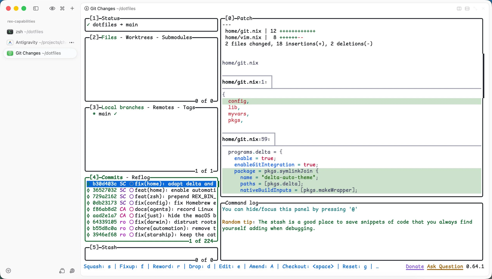

这几天做了一件挺有意思的事：把终端和日常用的 TUI、CLI 工具全部改成了跟随系统自动切换 Light 和 Dark 模式。

过去很长一段时间里，程序员的终端几乎默认是黑的。哪怕白天坐在采光很好的办公室里，浏览器、文档和聊天软件都是浅色背景，只要切到终端窗口，眼前就会立起一块黑底色块。以前不是没试过把终端改成浅色，但往往改了终端模拟器，里面的命令行工具就开始撞色：有的字浅得看不清，有的自己画了一块深色背景。为了省事，干脆全天候锁死在深色模式。

这几年情况变了不少。越来越多终端和 CLI 工具开始原生支持 `auto` 模式；翻了一些视觉工效学（Ergonomics）文献后我也确认了一件事：在明亮的办公环境里，浅色背景确实比深色背景更护眼。

## 明亮环境里，浅色背景为什么更护眼

终端默认黑底白字，最初是 CRT 显示器时代的硬件妥协。早期的 DEC VT100 或 IBM 5151 终端靠电子束轰击荧光粉发光，在 50Hz 到 60Hz 的刷新率下，如果把整块屏幕点亮，人眼会感受到剧烈的屏幕闪烁（flicker），长时间满屏扫描还会加速荧光粉老化甚至烧屏。只点亮字符笔画、保持背景全黑，是当年最合理的物理方案。后来图形界面普及了模拟纸张的浅底深字，也就是视觉工效学里说的正极性（Positive Polarity），但终端模拟器一路继承了 VT100 的配色习惯，黑底终端也就延续了下来。

如果只看人眼的光学成像规律，视觉工效学界对浅底深字（正极性）和深底浅字（负极性，Negative Polarity）做过几十年的对照实验，结论相当一致：在大多数阅读和文本校对任务中，浅色模式都具有稳定的正极性优势（Positive Polarity Advantage）。

德国杜塞尔多夫大学的 Axel Buchner 和 Cosima Piepenbrock 团队在 2009 年至 2014 年间发表过一组经典实验。他们先是独立分离了极性与屏幕整体亮度（display luminance）两个变量，证明正极性的阅读优势全部来自更高的屏幕整体光通量；[^buchner-2009] 随后又通过同步测量受试者的瞳孔直径，测出了背后的生理机制：[^piepenbrock-pupil]

**高亮度会收缩瞳孔，直接提升视网膜成像锐度**，浅色背景发出的光通量更高，会触发人眼的瞳孔对光反射，使瞳孔自然收缩。这和相机镜头缩小光圈是一个道理：更小的瞳孔孔径能增大景深（depth of field），同时大幅减少光线穿过晶状体边缘时产生的球面像差（spherical aberration）和眼内散射。文字边缘在视网膜上的成像更锐利，睫状肌不需要频繁调节去对焦。

**字号越小、字符越密，浅色模式的优势越明显**，同一团队在 *Human Factors* 上的实验测试了 8、10、12、14 pt 四种字号下的文本校对准确率与速度，发现随着字号缩小，浅色模式相对于深色模式的优势呈线性放大。[^piepenbrock-size] 这个结论正好命中终端的日常场景：看日志、审代码 diff、扫命令输出，满屏都是高密度小字号，而且经常要分辨 `;` 和 `:`、`1` 和 `l` 这种细微笔画差异。

**散光人群在深色模式下更容易出现光晕效应（halation）**，成年人里有大约 30% 到 50% 存在不同程度的散光。在深色模式下，因为屏幕整体偏暗，瞳孔会自动放大以增加进光量。光线穿过角膜外围曲率不均的区域时无法汇聚成单一点，亮色字符的边缘就会向黑色背景四周渗光、发虚。很多有散光的人看久了黑底白字容易眼酸、重影，原因就在这里。

环境光则是另一个关键变量。MIT AgeLab 的实验对比过日光级环境光与暗室环境下的快速阅读识别阈值，表现最差的组合正是暗环境配深色模式，此时瞳孔放到最大，光学像差最严重；而在明亮环境光或浅色显示下，识别速度都明显更快。[^dobres-2017] 白天在灯光明亮的办公室里，周围的墙面、桌面和浏览器页面都是高亮度，如果唯独终端是一块深色区域，视线每次在浏览器和终端之间来回切换，瞳孔都要经历一次收缩与放大的明暗适应。

不过文献里也有两处重要的边界，解释了为什么我们不该走向另一个极端：

一方面，人的主观偏好和实际生理表现常常背离。2023 年的一项眼动实验观察到，在明亮环境下使用深色模式会让搜索耗时、瞳孔直径和主观脑力消耗上升；但年轻受试者依然偏爱深色模式，很大程度上出于审美和氛围偏好，哪怕眼动数据显示他们的认知负荷并没有降低。[^sethi-2023] 2024 年的另一项视觉分析实验也印证了这一点：受试者主观上最喜欢的极性，往往不是他们做题最快、最准的那个。[^while-2024]

另一方面，暗光环境下浅色屏幕的眩光问题同样真实。哪怕在全黑房间里，纯看校对准确率依然是浅色模式更高；[^buchner-2007] 但在暗室或夜间关灯后，高亮度白屏会像手电筒一样造成强烈的视觉眩光。

所以最合理的做法，是让终端跟操作系统上的其他软件一样，白天用浅色，晚上切深色。

## 为什么现在终端能丝滑支持 Auto 模式了

早些年要在终端里做自动亮暗切换，得写不少胶水脚本：后台挂一个监听系统外观的进程，触发时去改终端、Tmux、Vim 的配置文件，再发信号让各个进程重载。[^arslan-2025]

这两年终端生态把这件事收敛成了三套标准机制，基本不再需要外部脚本介入：

**第一层是回归 ANSI 16 色语义映射**，过去很多命令行工具之所以在浅色终端里没法看，是因为配了写死的 24-bit TrueColor 主题（比如直接输出 `#cdd6f4` 的浅灰字）。现在像 Ghostty、WezTerm、Kitty 这类现代终端都原生支持同时配置 `light` 和 `dark` 两套调色板。只要让 Starship、fzf（`--color=base16`）、Atuin、Vim 这类工具只输出标准的 ANSI 0 到 15 号语义色，宿主终端在跟随系统切换外观时就会直接替换底层调色板，连屏幕上已经打印出来的历史输出都会在瞬间跟着变色。

**第二层是针对常驻 TUI 的 DEC Mode 2031 通知协议**，像 Zellij、Neovim、Helix、Yazi 这类自己管理复杂界面的全屏 TUI，往往需要维护独立的亮暗两套 TrueColor 主题。Contour 终端提出的 Mode 2031 协议规定：应用启动时发送 `CSI ? 2031 h` 订阅外观事件；当系统切换亮暗模式时，终端主动下发 `CSI ? 997 n` 通知，应用查询到当前是暗色（`CSI ? 997 ; 1 n`）还是亮色（`CSI ? 997 ; 2 n`）后，直接在内存里热切换主题，不再需要外部轮询。[^mode-2031]

**第三层是针对短生命周期命令的 `OSC 11` 背景探测**，像 `bat`、`delta` 这类跑完即退的 CLI 工具，启动时只需向终端发送 `\e]11;?\e\\` 查询当前背景色的 RGB 值，算出相对亮度后就能自动选择对应的语法高亮主题（例如 `bat` 内置的 `--theme=auto:system`）。

这里唯一剩下的盲区是**管道里的子进程**。`OSC 11` 查询要求进程直接连着控制终端（TTY）。当 `delta` 被 `lazygit` 这类上层 TUI 通过管道调用时，它的输入和输出都是 pipe，没法向终端发查询，就会退回默认的深色模式。对这种场景，直接读取操作系统的外观状态（比如 macOS 上的 `defaults read -g AppleInterfaceStyle`）再传参，就能补上最后一块拼图。

如果你也常年在明亮的办公室里盯着全黑的终端看小字号代码，不妨试着开启终端的 `auto` 模式。刚从黑底切到浅底可能会有一两天的陌生感，但适应之后，白天看高密度日志和代码 diff 时，眼睛的紧绷感确实会小很多。

[^buchner-2009]: Axel Buchner、Susanne Mayr、Martin Brandt，[The advantage of positive text-background polarity is due to high display luminance](https://pubmed.ncbi.nlm.nih.gov/19562598/)，*Ergonomics*，52(7):882-886，2009。
[^piepenbrock-pupil]: Cosima Piepenbrock、Susanne Mayr、Axel Buchner，[Smaller pupil size and better proofreading performance with positive than with negative polarity displays](https://pubmed.ncbi.nlm.nih.gov/25135324/)，*Ergonomics*，57(11):1670-1677，2014。
[^piepenbrock-size]: Cosima Piepenbrock、Susanne Mayr、Axel Buchner，[Positive display polarity is particularly advantageous for small character sizes: implications for display design](https://pubmed.ncbi.nlm.nih.gov/25141597/)，*Human Factors*，56(5):942-951，2014。
[^dobres-2017]: Jonathan Dobres、Nadine Chahine、Bryan Reimer，[Effects of ambient illumination, contrast polarity, and letter size on text legibility under glance-like reading](https://pubmed.ncbi.nlm.nih.gov/28166901/)，*Applied Ergonomics*，60:68-73，2017。
[^sethi-2023]: Tanvi Sethi、Mounia Ziat，[Dark mode vogue: Do light-on-dark displays have measurable benefits to users?](https://pubmed.ncbi.nlm.nih.gov/36533999/)，*Ergonomics*，66(12):1814-1828，2023。
[^while-2024]: Zack While、Ali Sarvghad，[Dark Mode or Light Mode? Exploring the Impact of Contrast Polarity on Visualization Performance Between Age Groups](https://arxiv.org/abs/2409.10841)，arXiv:2409.10841，2024。
[^buchner-2007]: Axel Buchner、N. Baumgartner，[Text - background polarity affects performance irrespective of ambient illumination and colour contrast](https://pubmed.ncbi.nlm.nih.gov/17510822/)，*Ergonomics*，50(7):1036-1063，2007。
[^arslan-2025]: Fatih Arslan，[Automatic dark mode for Terminal Apps, Revisited](https://arslan.io/2025/06/06/automatic-dark-mode-for-terminal-apps-revisited/)，2025 年 6 月 6 日。
[^mode-2031]: Contour Terminal，[Dark and Light Mode detection (DEC Mode 2031 / CSI ? 996 n)](https://contour-terminal.org/vt-extensions/color-palette-update-notifications/)，以及 [vtdn.dev Mode 2031 文档](https://vtdn.dev/docs/decset/mode2031-color-scheme/)。
